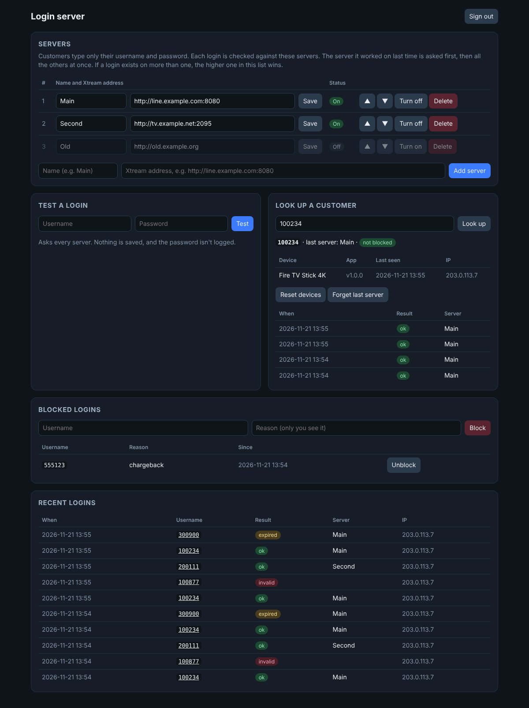

# Login server for the TV app

Customers type only a **username and password** in the app. The app sends them here. This server
checks them against **your list of IPTV servers** and answers with the server address the app
should play from.

```
TV app ──HTTPS──▶ auth.yourdomain.com/v1/login
                     │  asks your servers' player_api.php: "is this login valid?"
                     ▼
   ◀── { "server": "http://line.example.com:8080", "expires_at": … }
   then the app plays from that server exactly as before (Xtream API)
```

You manage the server list on a **web page** (`/admin`) or by editing **`config/servers.json`**.
Adding, replacing or switching off a server takes effect at once, with no app update.

- **No passwords are stored here.** The IPTV server checks every login live, so new
  accounts, renewals, expiry, bans and password changes on your servers apply straight away.
- **Fast:** the server a login worked on last time is asked first (one request). Only if that fails
  are all the other servers asked at the same time.
- **Extras:** block a login regardless of the server, an optional device limit per login, rate limits
  against password guessing, a login history, and `/v1/config` for app version, update link and notices.

---

## 1. Set up (once)

You need a small Linux VPS (1 vCPU / 512 MB is plenty) and a subdomain such as
`auth.yourdomain.com` with a DNS **A record pointing at the VPS**. Ports 80 and 443 must be open.

```bash
curl -fsSL https://get.docker.com | sh                 # install Docker
scp -r auth-server root@VPS:/opt/                      # from your PC: copy this folder up
```

On the VPS:

```bash
cd /opt/auth-server
cp .env.example .env              # set AUTH_DOMAIN and ADMIN_PASSWORD
cp config/app_config.example.json config/app_config.json
mkdir -p data && chown 10001 data config               # the container runs as user 10001
docker compose up -d --build
curl https://auth.yourdomain.com/healthz               # → {"ok": true, "servers": 0}
```

Caddy gets and renews the HTTPS certificate automatically. Then open
**https://auth.yourdomain.com/admin**, sign in with `ADMIN_PASSWORD` and add your servers.

## 2. The admin page



- **Servers:** add, rename, change address, turn off or on, delete, and set the order with ▲ ▼.
  Enter the **Xtream address customers play from** (e.g. `http://line.example.com:8080`), not a
  reseller panel's website. If a login exists on more than one server, the higher one wins.
- **Test a login:** asks every server and shows where it works, when it expires and its connection
  limit. Nothing is saved.
- **Look up a customer:** the last server they used, their devices and recent logins. *Reset devices*
  clears their device list (for the device limit). *Forget last server* makes the next login ask all
  servers again.
- **Blocked logins:** refuse a login whatever the server says (e.g. a chargeback).
- **Recent logins:** the last 40 attempts and their results.

Sign-in attempts are limited to 10 per 15 minutes per IP. You can also make the page reachable only
from your own IP: see the commented lines in `deploy/Caddyfile`.

## 3. Or edit `config/servers.json`

The admin page reads and writes this file, and you can also edit it by hand. Changes are picked up
automatically, with no restart. Order = priority.

```json
{
  "servers": [
    { "id": "main01", "name": "Main",   "url": "http://line.example.com:8080", "enabled": true },
    { "id": "back02", "name": "Second", "url": "http://tv.example.net:2095",   "enabled": true },
    { "id": "old003", "name": "Old",    "url": "http://old.example.org",       "enabled": false }
  ]
}
```

`id` can be any short text but must stay the same once in use (it's how the "last server" of each
login is remembered).

## 4. Command line (optional)

Everything on the page also works from the VPS:

```bash
alias auth='docker compose exec auth python manage.py'
auth servers
auth add-server http://line.example.com:8080 --name Main
auth remove-server Main
auth test 123456789            # asks for the password, tries every server
auth show 123456789
auth block 123456789 --reason "chargeback"
auth unblock 123456789
auth devices 123456789 --forget
auth log --limit 50
```

## 5. Settings (.env)

| Setting | Default | What it does |
|---|---|---|
| `AUTH_DOMAIN` | – | Public address; Caddy gets its certificate |
| `ADMIN_PASSWORD` | empty | Password for `/admin`. Empty = page switched off |
| `MAX_DEVICES` | `0` | Different devices per login in the last 30 days (0 = unlimited). Your servers' own connection limits still apply to streams |
| `SERVER_TIMEOUT` | `8` | Seconds to wait for each IPTV server |
| `RATE_IP_PER_5MIN` | `30` | Login attempts per IP per 5 minutes |
| `RATE_USER_FAILS_PER_15MIN` | `8` | Wrong passwords per login per 15 minutes before it's paused |

Run **one** worker only (the default). Rate limits are kept in memory. After changing `.env`:
`docker compose up -d`.

## Failsafes: no unnecessary calls to your IPTV servers

| Situation | What happens |
|---|---|
| Customer opens the app again (same login) | Answered from memory for `CACHE_OK_SECONDS` (30 min): **0 IPTV calls** |
| Same wrong login repeated | Answered from memory for `CACHE_FAIL_SECONDS` (10 min): **0 IPTV calls** (still counts toward the rate limit) |
| New or moved login | Servers asked **one at a time**, last-used server first, then your list order; **stops at the first match** |
| A server doesn't answer | Skipped for `SERVER_DOWN_SECONDS` (2 min, doubling up to 10 min while it stays down) |
| Rush or attack | At most `SERVER_RATE_PER_MIN` (30) checks a minute reach any one server |
| One login check | Never spends more than 20 s asking servers in total |

Memory is in the server process only, never on disk. Logins are remembered by a one-way
fingerprint, never the password. A remembered login is checked again when its server is switched off
or removed, or when the account's expiry date passes. A remembered wrong login is checked again when
you change the server list. Blocking someone on the admin page works immediately. **Forget remembered
logins** on the admin page makes every login get checked with the servers again.

The app adds its own limit: it checks the account **at most every 6 hours** (plus right after
sign-in and on a manual Reload), and waits 15 minutes before retrying if the login server can't be
reached.

## How a login is decided

1. Blocked? → refused.
2. Remembered from the last 30 minutes? → answered without asking any server.
3. Ask the server this login worked on last time. Valid → done.
4. Otherwise ask the other enabled servers one at a time, in list order, skipping any that are down
   or busy. The first that knows the login wins and is remembered.
5. Valid password but expired / banned / disabled on that server → refused with that reason.
6. Not found anywhere → "wrong username or password". If some server didn't answer, it isn't counted
   as a wrong attempt. If *their* last server, or every server, didn't answer → "try again shortly".

Note: a new wrong password is tried on each server once (then remembered), so the servers see far fewer
failed attempts.

## Backups

All state is in `data/auth.db` (blocks, devices, last server, history) plus `config/servers.json`.
Copy both folders now and then. Losing the database only means logins ask all servers once again.

---

## API (for the Android app)

### `POST /v1/login`

```json
{
  "username": "123456789",
  "password": "secret",
  "device_id": "random-uuid-saved-on-first-start",
  "device_name": "Fire TV Stick 4K",
  "app_version": "1.0.0"
}
```

Success, **200**:

```json
{
  "ok": true,
  "server": "http://line.example.com:8080",
  "username": "123456789",
  "expires_at": "2026-12-21T05:00:00+00:00",
  "max_connections": 2,
  "checked_at": 1763740000,
  "config": { "min_version": "1.0.0", "latest_version": "1.0.0", "update_url": "…", "notice": "", "support": "…" }
}
```

`expires_at` is `null` for accounts that never expire.

Failure: `{"ok": false, "error": "<code>", "message": "<show this to the user>"}`

| HTTP | `error` | App should |
|---|---|---|
| 400 | `bad_request` | Ask for username and password |
| 401 | `invalid_credentials` | Show message, back to login screen |
| 403 | `expired` (also has `expires_at`), `banned`, `disabled`, `blocked`, `too_many_devices` | Show message + support contact; don't play |
| 429 | `rate_limited` (also `retry_after` seconds) | Show message, wait |
| 503 | `server_unreachable` | **Keep playing from the last saved server**, if there is one |

### `GET /v1/config` and `GET /healthz`

`/v1/config` returns `config/app_config.json` as-is (update prompts and notices before login).
`/healthz` returns `{"ok": true, "servers": N}` for uptime monitors.

## Tests

```bash
pip install -r requirements.txt pytest requests
python -m pytest -q
```

27 end-to-end tests run the real server against fake IPTV servers. They cover: finding the right
server, the remembered-server fast path, customers who moved servers, priority order, expired and
banned accounts, blocks, servers switched off or edited by hand, servers that are down, rate limits,
the device limit, malformed requests, passwords never reaching the log, and the admin page (sign-in,
CSRF protection, server editing, test, block, HTML escaping).
